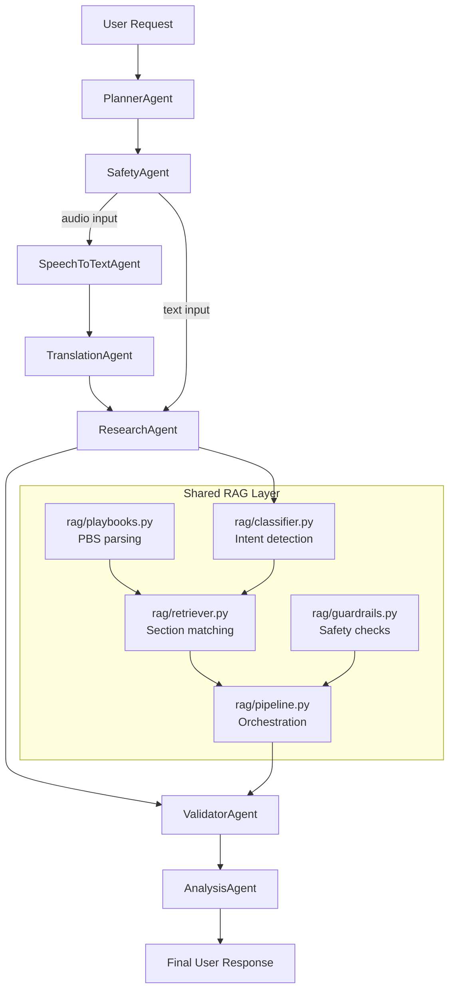

# Mini Voice Bot: NLP & Partitioned RAG System

A voice-to-action pipeline that transcribes audio with OpenAI Whisper and translates foreign spoken language into English text using a multi-agent pipeline, validates input and output safety using `llm-guard`, categorizes user intent across multi-label domains, and retrieves structured troubleshooting solutions from playbook markdown files (`pbs/`) preserving full semantic context.

---

## Architecture Overview



1. **Audio Preprocessing & Augmentation (`annotation/`)**:
   - Cleans background noise and normalizes audio via `clean_audio.py`.
   - Applies audio data augmentation via `augment.py` before inference.
2. **Complex Multi-Agent Workflow (`agents/`, run via `annotation/transcribe.py`)**:
   The system now uses a dependency-aware multi-agent flow instead of a single straight chain.
   - **PlannerAgent**: decides whether the request is text or audio and routes to the appropriate workflow.
   - **SafetyAgent**: validates the incoming payload and blocks unsafe requests before research begins.
   - **SpeechToTextAgent**: handles audio transcription when audio is present.
   - **TranslationAgent**: translates audio transcripts to English so the RAG layer can process them consistently.
   - **ResearchAgent**: executes the RAG research stage and produces the best matching PBS sections.
   - **ValidatorAgent**: checks confidence and match quality before sending the result to final synthesis.
   - **AnalysisAgent**: converts the validated result into the final user-facing response.
   - **`agents/orchestrator.py`**: assembles the workflow and exposes `run_voice_workflow(...)` and `run_text_workflow(...)` for reuse.
3. **Input Guardrails (`rag/guardrails.py`)**:
   - Runs PII anonymization (via `Vault`), toxicity filtering, and prompt injection screening with false-positive filtering for translated conversational speech.
4. **Intent Classification (`rag/classifier.py`)**:
   - Multi-label Zero-Shot Transformer classifier (`transformers.pipeline`) with an intelligent stem-aware keyword fallback.
   - Dispatches across supported categories:
     - `image_file_troubleshooting`
     - `engineering_task_assignment`
     - `technical_support`
     - `billing`
     - `account_access`
     - `general_inquiry`
5. **Context-Preserving Playbook RAG (`rag/playbooks.py` + `rag/retriever.py`)**:
   - Loads modular markdown/text playbooks from the `pbs/` directory.
   - Splits by heading and section blocks rather than naive character slicing, preserving sentence continuity.
   - Partitions retrieval to match predicted categories and keep the best section matches for validation and final analysis.
6. **Output Guardrails (`rag/guardrails.py`)**:
   - Scrubs credentials, sensitive tokens, and maps vault tokens back into deanonymized safe text.
7. **FastAPI Service (`api/server.py`)**:
   - Exposes REST endpoints for querying the pipeline directly over HTTP and now routes through the agent workflow instead of directly calling the RAG pipeline.

---

## Project Structure

```text
mini-voice-bot/
├── annotation/
│   ├── clean_audio.py        # Audio noise cleaning and normalization
│   ├── augment.py            # Audio dataset augmentation
│   └── transcribe.py         # Runs the agent workflow and prints the final answer
├── agents/
│   ├── base.py               # Agent, Message, MessageBus primitives
│   ├── orchestrator.py       # Registers the dependency-aware workflow and exposes run_*_workflow(...)
│   ├── planner_agent.py      # Plans the request path (audio/text)
│   ├── safety_agent.py       # Validates safety and routes for execution
│   ├── stt_agent.py          # Speech-to-text (Whisper)
│   ├── translation_agent.py  # Text-to-English (MarianMT)
│   ├── research_agent.py     # RAG research job against PBS playbooks
│   ├── validator_agent.py    # Validates match strength and confidence
│   ├── analysis_agent.py     # Summarizes the research into a user response
│   └── __init__.py           # Exports the multi-agent layer and orchestration API
├── api/
│   └── server.py             # FastAPI REST endpoints (/voice, /resolve)
├── rag/
│   ├── __init__.py           # Public RAG package exports
│   ├── config.py             # Categories, keywords, playbook defaults
│   ├── models.py             # KnowledgeDocument data model
│   ├── playbooks.py         # PBS discovery and parsing logic
│   ├── classifier.py         # Intent classification logic
│   ├── retriever.py          # Matching and ranking of relevant PBS sections
│   ├── guardrails.py        # Safety validation + output sanitization
│   └── pipeline.py           # Research orchestration and user-summary factory
├── pbs/                      # Knowledge base playbooks (auto-seeded if empty)
│   ├── image_file_troubleshooting.md
│   ├── engineering_task_assignment.md
│   ├── technical_support.md
│   ├── billing.md
│   └── account_access.md
├── requirements.txt
├── README.md
└── .venv/
```

---

## Setup & Installation

> **Note**: Whisper requires `ffmpeg` installed on your system PATH to read and decode audio files.

1. **Activate Virtual Environment**:

   ```powershell
   .\.venv\Scripts\Activate.ps1
   ```

2. **Install Core Dependencies**:
   ```bash
   pip install -r requirements.txt
   ```

---

## Running the Services

### 1. Preprocess Audio

Before executing transcription, run the preprocessing scripts from the `annotation` directory:

```bash
cd annotation
python clean_audio.py
python augment.py
cd ..
```

Or run them directly from the project root:

```bash
python annotation/clean_audio.py
python annotation/augment.py
```

### 2. Run Audio Transcription & RAG Pipeline

Run the speech-to-text and translation agents, then the end-to-end RAG analysis (the first run downloads a translation model for non-English audio):

```bash
python annotation/transcribe.py
# Or specify a custom audio target (e.g. French billing sample):
python annotation/transcribe.py message_facturation_fr.wav
```

### 2. Start the FastAPI Web Server

Start the server with hot-reload enabled:

```bash
uvicorn api.server:app --reload --host 0.0.0.0 --port 8000
OR
python -m uvicorn api.server:app --reload
```

### 3. API Endpoints

- **GET `/voice?text=<query>`**:
  Pass query text as a URL parameter:
  ```bash
  curl -X GET "http://127.0.0.1:8000/voice?text=Uploaded%20PNG%20images%20are%20failing%20and%20need%20to%20assign%20to%20engineer"
  ```
- **POST `/resolve`**:
  Send JSON payload:
  ```bash
  curl -X POST "http://127.0.0.1:8000/resolve" -H "Content-Type: application/json" -d "{\"text\": \"My audio device has distorted sound.\"}"
  ```
